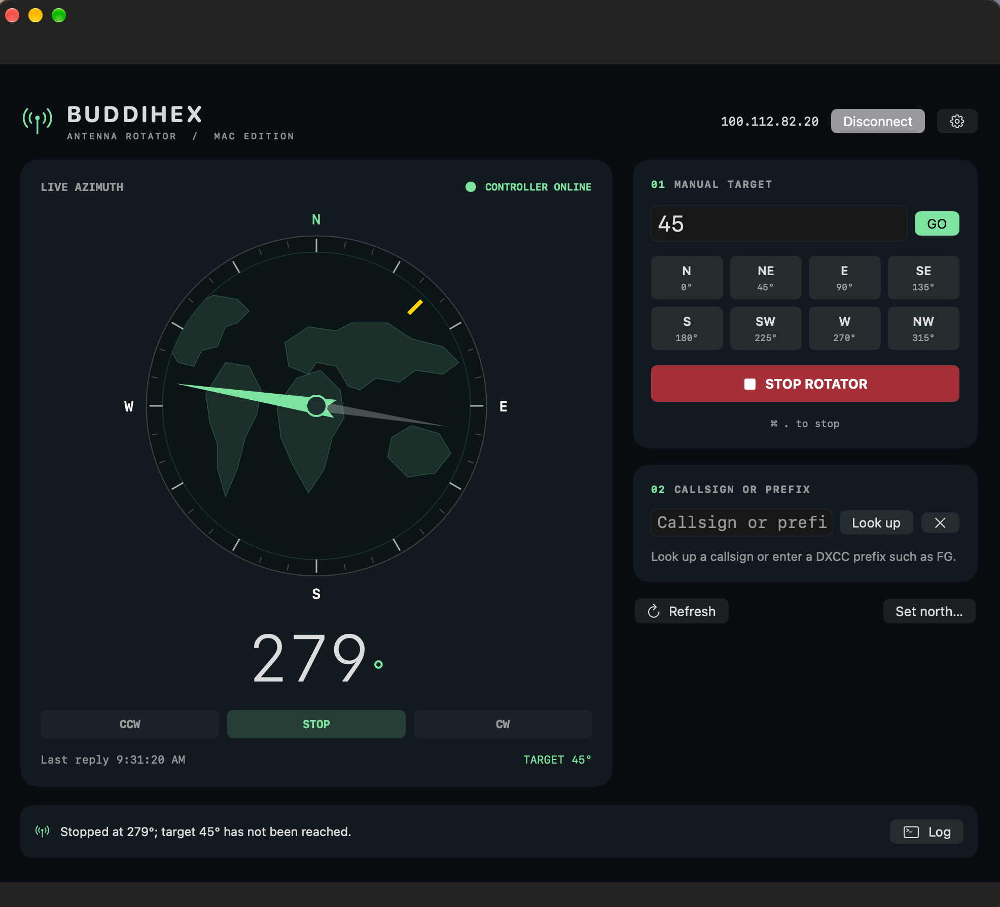
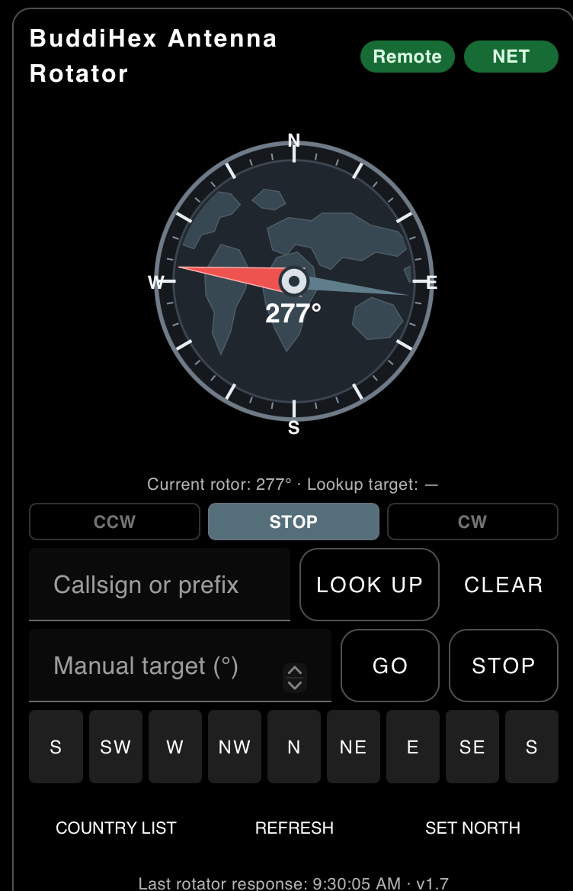

# BuddiHex Rotator

Control a BuddiHex R4 antenna rotator from a native macOS app or a Node-RED Dashboard 2 panel. Both interfaces show the current bearing, support manual and preset headings, and can look up a bearing by callsign using QRZ or the DXCC country list.

## Notice

These applications are intended to be used with the Buddihex Rotator created by NT8B, KD4MM and KA4CDN.

- [3D Printer Files](https://www.printables.com/model/960091-mastwerks-buddihex-remote-mast-rotator-v2)
- [PC Board](https://www.pcbway.com/project/shareproject/MastWerks_BuddiHex_Remote_Mast_Rotator_Control_Board_v1_1_d22fbad5.html)
- [Firmware](https://github.com/mdannhardt/rotatorControllerESP8266)
- [Windows App](https://github.com/mdannhardt/HexbeamRotatorControl)

This application is not compatible with the Mastwerks rotator engineered and distributed by Buddipole / Mastwerks.

## Downloads

| Download | What it includes |
| --- | --- |
| [BuddiHex Rotator v1.7.1 Universal DMG](./BuddiHex-Rotator-v1.7.1-Universal.dmg?raw=true) | Mac installer for Intel and Apple Silicon |
| [BuddiHex Rotator v1.7.1 Apple Silicon DMG](./BuddiHex-Rotator-v1.7.1-Apple-Silicon.dmg?raw=true) | Mac installer for Apple Silicon only |
| [BuddiHex User Guide (PDF)](./BuddiHex-User-Guide.pdf?raw=true) | Mac and Node-RED setup, rotator controls, Raspberry Pi, SmartSDR, and Tailscale |
| [BuddiHex Node-RED v1.7 flow (JSON)](./BuddyHexNodeRed-v1.7.json?raw=true) | Importable FlowFuse Dashboard 2 flow |

## Repository files

| File | Purpose |
| --- | --- |
| `BuddiHex-Rotator-v1.7.1-Universal.dmg` | The Universal Mac app and Applications shortcut |
| `BuddiHex-Rotator-v1.7.1-Apple-Silicon.dmg` | The Apple Silicon Mac app and Applications shortcut |
| `BuddiHex-User-Guide.pdf` | Installation, configuration, everyday operation, and troubleshooting |
| `BuddyHexNodeRed-v1.7.json` | Node-RED flow with a compass, live status, heading controls, STOP, callsign lookup, and Country List updates |
| [`Pi/buddihex_bridge.py`](Pi/buddihex_bridge.py) | Python service that links BuddiHex and Hamlib rotctld clients to the ESP8266 |
| [`Pi/buddihex-bridge.conf`](Pi/buddihex-bridge.conf) | Example bridge configuration for the controller address, listen address, and ports |
| [`Pi/buddihex-bridge.service`](Pi/buddihex-bridge.service) | systemd service definition for starting the bridge at boot |

## Screenshots

### BuddiHex for macOS

### BuddiHex Node-RED Dashboard

## Quick start

### Mac app

Requires macOS 13 or later. Open the DMG and drag **BuddiHex Rotator** into Applications. Under **Settings → Controller**, select **Direct to rotator (UDP)** and enter the ESP8266 address, or select **Raspberry Pi bridge (TCP)** and enter the Pi address and port **4533**. Save, click **Connect**, and verify the current bearing before moving the antenna. These builds are ad hoc signed and lack Apple notarization.

### Node-RED

Install **FlowFuse Dashboard 2**, import the JSON, and open its **CONFIG** Function node. Set `connectionType` to `"direct"` for the ESP8266 or `"remote"` for the Pi bridge or a standard Hamlib rotctld server. Edit the matching address and ports, then deploy and open `/dashboard/page1` on your Node-RED host.

The panel shows **Direct** in blue or **Remote** in green. Standard Hamlib provides bearing, turn, and stop. Use the BuddiHex Pi bridge or a direct connection for full controller feedback and Set North.

### Raspberry Pi bridge

Follow the [PDF guide](./BuddiHex-User-Guide.pdf?raw=true) to install the Python service and systemd unit. The bridge listens on **TCP 4533** and uses UDP **4210** for ESP8266 commands and **4211** for replies. SmartSDR connects using **Hamlib rotctld**. The guide also covers access over Tailscale.

Use one client to talk directly to the ESP8266, or connect your clients through the Pi bridge and issue movement commands from one client at a time.
